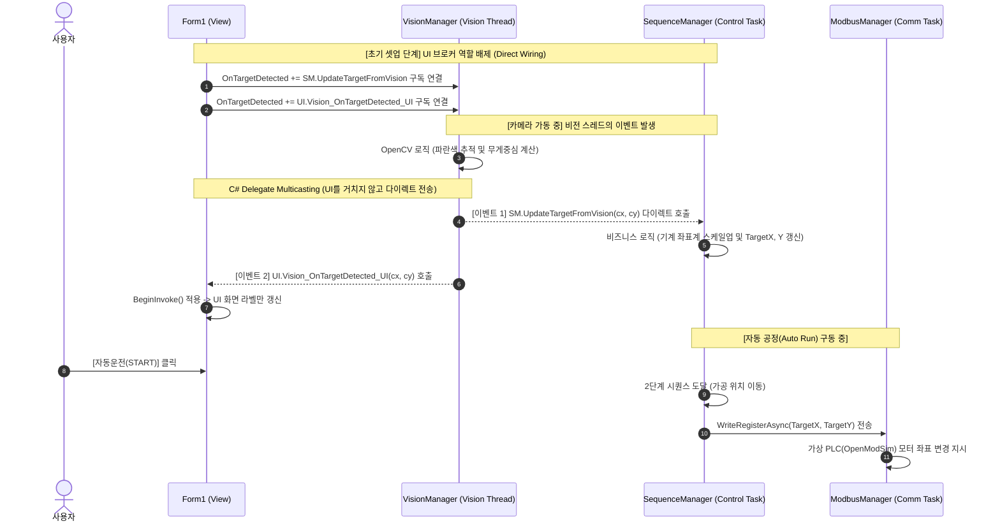

# C# 기반 3축 장비 제어 및 스마트팩토리 관제(MES) 시스템


## 프로젝트 개요
본 프로젝트는 산업 현장의 3축 자동화 설비(반도체 핸들러/디스펜서 등)와 상위 관제 시스템(MES)을 모사한 **PC 기반 제어 S/W 포트폴리오**입니다. 
실물 PLC 대신 `OpenModSim` 가상 시뮬레이터를 활용하여 **Modbus TCP 통신, 멀티스레드 기반 상태 머신(FSM) 제어, 안전 인터락, 머신비전 연동 및 데이터베이스 로깅** 등 현업 장비 제어의 핵심 아키텍처를 구현했습니다.

### 구동 시연 영상
**https://youtu.be/O9Un_2HxzwQ**

---

## 핵심 아키텍처 및 설계 포인트

이 프로젝트는 UI 폼(Form1)이 비즈니스 로직을 모두 떠안는 안티패턴(God Object)을 방지하고, **단일 책임 원칙(SRP)**을 준수하기 위해 모듈을 철저히 분리했습니다.

### 1. 스레드 분리 및 크로스 스레드 방어
* **UI Thread (View):** 사용자 입력 처리 및 화면 갱신 (`BeginInvoke` 활용 크로스 스레드 방지)
* **Comm Task (ModbusManager):** 100ms 주기로 가상 PLC와 I/O 데이터를 비동기로 주고받으며 UI 프리징 방지
* **Control Task (SequenceManager):** 장비의 FSM(상태 머신) 관리 및 Homing / Auto Run 공정 무한 루프 구동
* **Vision Thread (VisionManager):** OpenCV 기반 타깃 추적 및 좌표 계산 전담

### 2. 비전 연동 모듈 간 직접 연결 (Direct Wiring)
UI가 데이터를 가공하고 중개하는 결합도를 낮추기 위해, C# 델리게이트 멀티캐스팅을 활용해 모듈 간 데이터를 다이렉트로 연결했습니다.




---

## 💡 주요 구현 기능 (5대 핵심 요소)

1. **수동 제어 (Manual Mode) & Homing**
* X, Y, Z축 수동 JOG 이동 및 물리적 간섭을 방지하는 안전 Homing(원점 복귀) 시퀀스 구현


2. **자동 공정 상태 머신 (FSM: Finite State Machine)**
* `IDLE` -> `RUNNING` -> `PAUSE` -> `ALARM` 상태 정의
* `CancellationToken`을 활용한 백그라운드 공정 루프 제어 및 대기(Delay) 구현


3. **안전 인터락 (Safety Interlock) & 비상정지(EMO)**
* 가상 도어(Door) 열림 감지 시 소프트웨어 인터락 발동 및 모터 동작 원천 차단
* 비상정지(EMO) 즉각 대응 및 알람 발생 처리


4. **MES 데이터베이스 연동 (SQLite)**
* 가공 사이클(Tact Time) 종료 시 양품/불량 판정 결과 및 Lot ID를 로컬 DB에 트랜잭션 기록
* 실시간 일일 생산량 및 가동률 대시보드 표출


5. **비전 유도 모션 (Vision Guided Motion)**
* `OpenCvSharp4`를 활용해 웹캠에서 특정 타깃 영역의 무게중심을 추출
* 실시간으로 산출된 픽셀 좌표를 기계 좌표계로 변환하여 제어 FSM의 목표 위치로 동기화


---

## 🚀 실행 방법

1. [OpenModSim](https://github.com/sanny32/OpenModSim/releases) 실행 후 `Modbus TCP` 통신 포트 `502` 개방
2. `Setup -> Slave Definition`에서 `Holding Register` 주소 0번부터 20개 할당
3. Visual Studio 2022에서 솔루션 빌드 및 실행 (`F5`)

```
